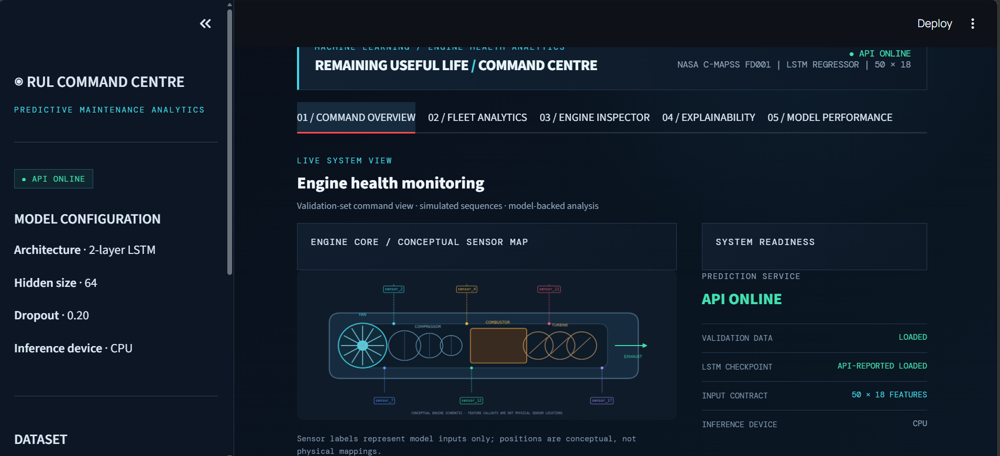
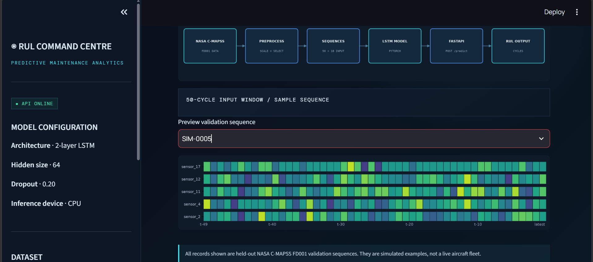
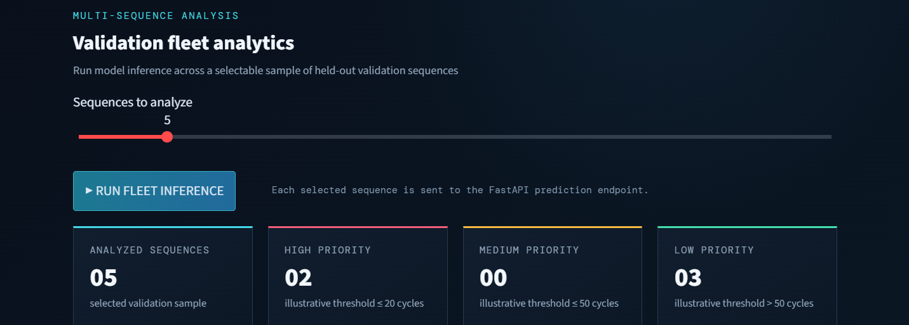
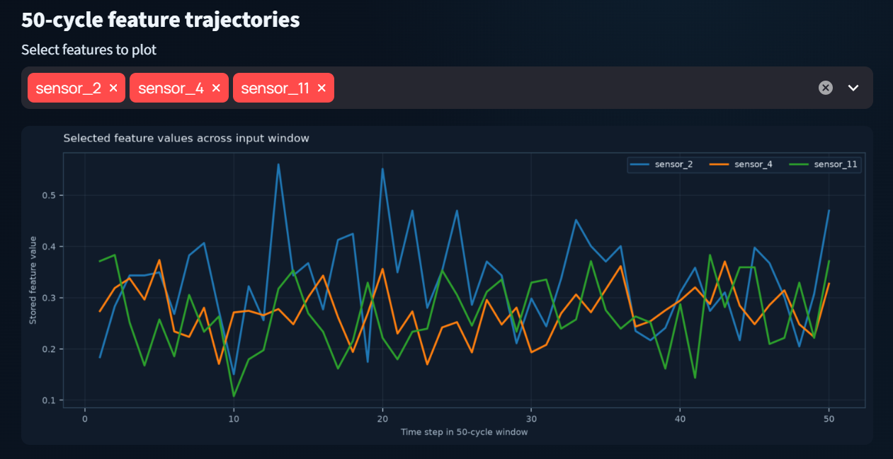
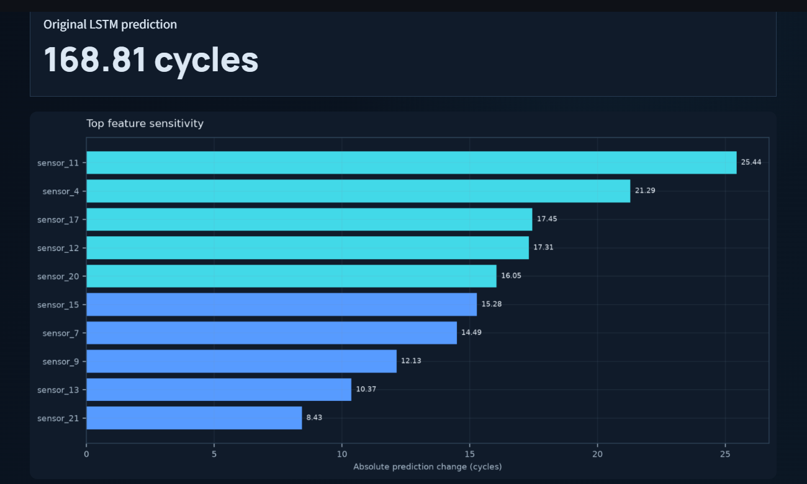
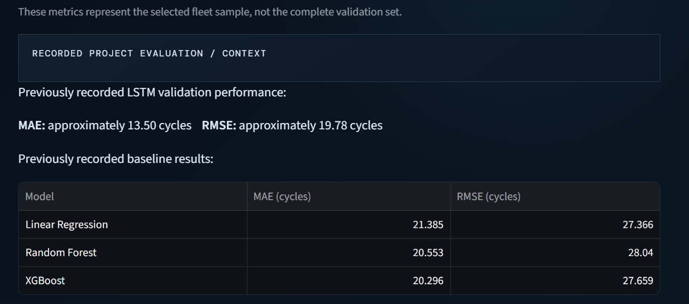
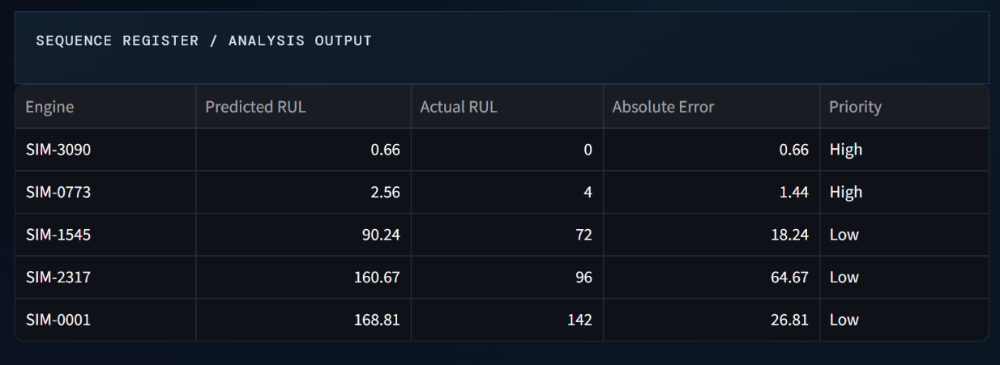

# RUL Predictive Maintenance

## Overview

RUL Predictive Maintenance is a machine learning project that estimates the Remaining Useful Life (RUL) of aircraft turbofan engines using NASA's C-MAPSS FD001 dataset.

The project combines classical machine learning models and a Long Short-Term Memory (LSTM) neural network to estimate the number of operational cycles remaining before engine failure.

It also provides a FastAPI prediction service and an interactive Streamlit dashboard for exploring predictions, engine sequences, fleet-level analytics, and model explainability.

## Objectives

- Estimate engine Remaining Useful Life using historical sensor measurements.
- Compare classical machine learning models with an LSTM-based approach.
- Process time-series sensor data into fixed-length sequences.
- Expose model predictions through a REST API.
- Visualize predictions and model behaviour through an interactive dashboard.
- Explore model sensitivity using feature occlusion.

## Dataset

The project uses NASA's C-MAPSS FD001 dataset.

The raw training file is expected at:

`data/train_FD001.txt`

The dataset contains engine identifiers, operational cycles, three operational settings, and 21 sensor measurements.

Raw datasets and generated model artifacts are excluded from version control. Place the dataset in the expected location and generate the required artifacts before running the application.

## Methodology

### 1. Data Preprocessing

- Dataset ingestion and preprocessing.
- Removal of seven selected sensor measurements.
- Calculation of uncapped Remaining Useful Life (RUL).
- Engine-wise 80/20 training and validation split.
- Feature scaling fitted on training data only.
- Generation of fixed-length sequences containing 50 consecutive cycles.

### 2. Retained Features

The model uses 18 input features:

1. cycle
2. op_setting_1
3. op_setting_2
4. op_setting_3
5. sensor_2
6. sensor_3
7. sensor_4
8. sensor_7
9. sensor_8
10. sensor_9
11. sensor_11
12. sensor_12
13. sensor_13
14. sensor_14
15. sensor_15
16. sensor_17
17. sensor_20
18. sensor_21

The cycle feature is left unscaled. Operational settings and retained sensor features are scaled using MinMaxScaler.

### 3. Sequence Generation

Each sequence contains 50 consecutive cycles from a single engine.

The target is the RUL at the final cycle of the sequence. Sequences never cross engine boundaries.

The resulting arrays have the following formats:

| Array | Shape |
|---|---|
| X_train | (N, 50, 18) |
| y_train | (N,) |
| X_val | (M, 50, 18) |
| y_val | (M,) |

### 4. Classical Machine Learning Baselines

The following models were trained and evaluated:

- Linear Regression
- Random Forest Regressor
- XGBoost Regressor

The baseline models use features from the final timestep of each sequence.

### 5. LSTM Model

A two-layer LSTM network is used to learn temporal patterns from the 50-cycle input sequences.

The architecture includes:

- Input: 50 time steps and 18 features.
- Two LSTM layers.
- Hidden size: 64.
- Dropout: 0.2.
- Regression head: 64 → 32 → 1.
- Output: predicted RUL in operational cycles.

The model is implemented using PyTorch.

## Model Performance

### Classical Baseline Results

| Model | MAE | RMSE |
|---|---:|---:|
| Linear Regression | 21.3850 | 27.3663 |
| Random Forest | 20.5529 | 28.0397 |
| XGBoost | 20.2959 | 27.6585 |

### LSTM Results

| Metric | Validation Result |
|---|---:|
| MAE | 13.5047 cycles |
| RMSE | 19.7819 cycles |

The LSTM uses the complete 50-timestep sequence, whereas the baseline models use only final-timestep features. Therefore, the comparison should be interpreted with this difference in input representation in mind.

These are validation results, not official NASA test-set results.

## API

The project uses FastAPI to expose the trained LSTM model.

Available endpoints:

| Endpoint | Method | Description |
|---|---|---|
| `/` | GET | API root |
| `/health` | GET | Checks API and model status |
| `/predict` | POST | Returns predicted RUL for an input sequence |

The prediction endpoint expects a 50 × 18 already-scaled input sequence.

The API returns the predicted RUL in operational cycles.

Interactive API documentation is available at:

`http://127.0.0.1:8000/docs`

## Dashboard Preview

The application provides an interactive dashboard for monitoring engine health, analyzing fleet-level predictions, and understanding model behaviour.

### Command Overview


### Sequence Workflow


### Fleet Analytics


### Engine Inspector


### Feature Explainability


### Model Performance


### Prediction Results


## Interactive Dashboard

The Streamlit dashboard provides the following sections:

- **Command Overview:** API status, project workflow, and system overview.
- **Fleet Analytics:** Fleet-level predictions, RUL distribution, and error analysis.
- **Engine Inspector:** Individual sequence inspection, actual versus predicted RUL, and sensor trends.
- **Explainability:** Feature occlusion analysis to examine model sensitivity to individual features.
- **Model Performance:** Validation metrics and baseline comparisons.

The dashboard communicates with the FastAPI backend to obtain predictions.

## Explainability

Feature occlusion is used to examine how replacing individual input features with baseline values affects the model's predicted RUL.

The resulting changes indicate model sensitivity to the selected features. They do not establish causal relationships between sensor measurements and engine failure.

## Technologies Used

- Python
- NumPy
- Pandas
- Scikit-learn
- PyTorch
- XGBoost
- FastAPI
- Streamlit
- MLflow
- Matplotlib
- Seaborn
- Joblib

## Project Structure

```text
RUL-Predictive-Maintenance/
├── app/
│   └── dashboard.py
├── data/
│   └── train_FD001.txt
├── artifacts/
│   ├── lstm_model.pt
│   ├── feature_scaler.joblib
│   └── other generated model artifacts
├── src/
│   ├── api/
│   │   └── main.py
│   ├── explainability/
│   │   └── feature_occlusion.py
│   ├── features/
│   │   └── build_sequences.py
│   └── models/
│       ├── data_ingestion.py
│       ├── baseline_train.py
│       ├── evaluate_lstm.py
│       ├── lstm_model.py
│       ├── train_lstm.py
│       └── track_lstm.py
├── tests/
├── reports/
├── requirements.txt
├── .gitignore
└── README.md
```

## Installation and Setup

Clone the repository:

```bash
git clone https://github.com/aditipradhan18/RUL-Predictive-Maintenance.git
cd RUL-Predictive-Maintenance
```

Create and activate a virtual environment:

```bash
python -m venv .venv
```

Windows:

```cmd
.venv\Scripts\activate
```

Install dependencies:

```bash
pip install -r requirements.txt
```

Place the NASA C-MAPSS FD001 training file at:

`data/train_FD001.txt`

Generate the preprocessing outputs, model artifacts, and trained model using the project scripts before starting the API.

## Running the Application

### Start the FastAPI backend

```bash
uvicorn src.api.main:app --reload
```

API documentation:

`http://127.0.0.1:8000/docs`

### Start the Streamlit dashboard

Open a second terminal, activate the virtual environment, and run:

```bash
streamlit run app/dashboard.py --server.port 8502
```

Dashboard:

`http://localhost:8502`

The FastAPI backend must be running for dashboard predictions to work.

## Limitations

- The project uses the NASA C-MAPSS FD001 dataset rather than live aircraft telemetry.
- Model performance is evaluated using a validation split of the training dataset.
- Baseline and LSTM models use different input representations.
- Feature occlusion measures model sensitivity and does not prove causality.
- Priority categories displayed in the dashboard are illustrative thresholds, not certified maintenance recommendations.
- This project is an academic demonstration and is not certified or intended for operational aircraft maintenance decisions.

## Conclusion

The project demonstrates an end-to-end predictive maintenance workflow combining time-series preprocessing, classical machine learning, LSTM-based RUL estimation, API deployment, interactive visualization, and model explainability.

It provides a foundation for exploring how machine learning can support condition monitoring and predictive maintenance research.